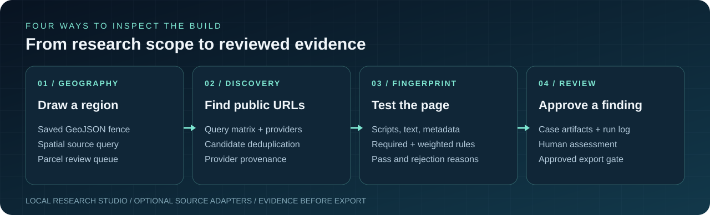
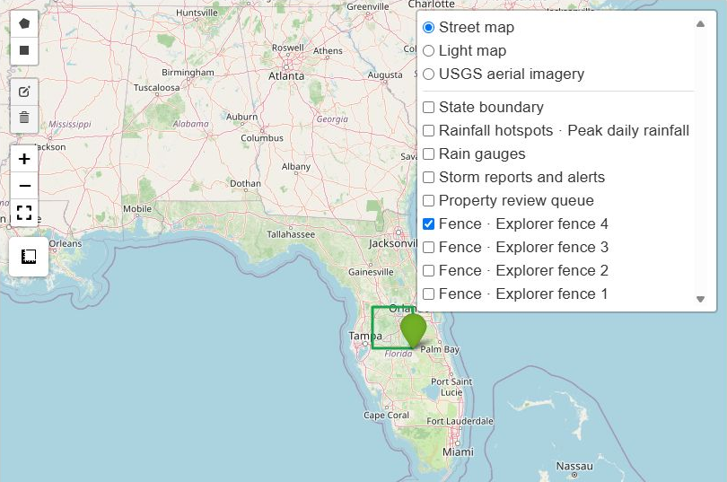
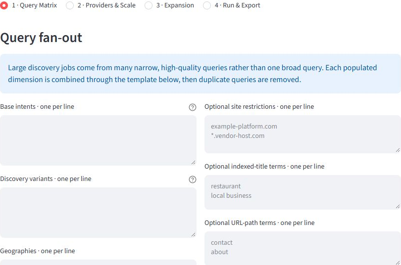
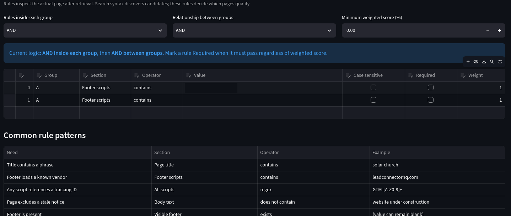
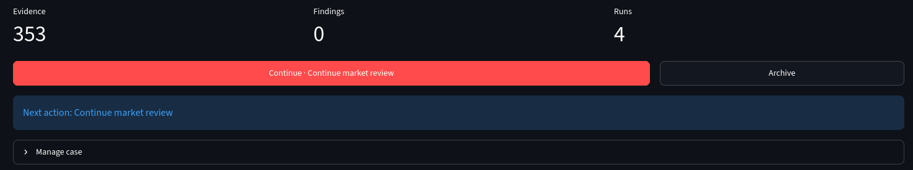
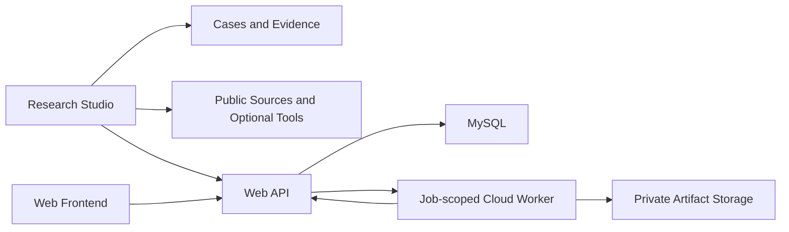

<div align="center">


# OSINT Dive Deep v1

**Draw a research boundary. Discover public evidence. Decide what qualifies.**

A local-first investigation studio for geographic research, web discovery, technology fingerprints, and case review.

[](LICENSE)
[](docs/SETUP.md)
[](https://github.com/RawPowered/osint-dive-deep-v1/actions/workflows/verify.yml)

[Explore the map](#geographic-research) · [Trace discovery](#online-fingerprint-collection) · [Inspect the rules](#technology-fingerprint-discovery) · [Review the evidence](#quality-control)

</div>



Follow one candidate through the build. A map fence or search plan defines the scope. Source adapters collect public material with provenance. Filters and page rules test relevance. A person reviews the case record before an approved export.

| Review path | What it demonstrates |
| --- | --- |
| **Geographic research** | Drawn polygon → saved GeoJSON → spatial public-source query → normalized property queue. |
| **Online fingerprints** | Query matrix → independent discovery providers → deduplicated, source-attributed URLs. |
| **Technology fingerprints** | Retrieved page → script and content rules → explicit pass or rejection reasons. |
| **Quality control** | Candidate → artifact → reviewed finding → gated export. |

## Geographic research

In **Property Explorer**, an investigator draws a polygon or rectangle over a region and saves its coordinates as GeoJSON case evidence. The Florida path queries a public statewide cadastral FeatureServer for parcels intersecting that geometry. A custom path accepts a permitted public ArcGIS layer for another region. The collector preserves raw source responses and normalizes available parcel identifiers, addresses, coordinates, ownership fields, and other facts into a durable review queue. Coverage and field completeness depend on the source.

Street, light, and USGS aerial basemaps provide visual context. State boundaries and weather overlays are optional. Individual address lookup is separate from polygon collection. Export requires an explicit review state and eligible next action.

<div align="center"><br /><sub>Isolated local case, October 2026. The outlined fence was saved as GeoJSON; this image does not represent a successful parcel query.</sub></div>

**Trace the implementation:** [Geo Explorer workflow](studio/GEO_EXPLORER.md) · [map interface](studio/osint_studio/geo_explorer.py) · [spatial collection](studio/osint_studio/property_service.py) · [review gate](studio/osint_studio/property_store.py).

## Online fingerprint collection

The **Discovery** workspace builds a query matrix from an intent, variants, geography, and operators such as site, title, URL, and file type. Its public-web lane can use DDGS, optional Brave and urlscan sources, and Common Crawl URL inventory. Sitemap and bounded same-domain expansion add candidate paths. Persistent jobs retain URLs, provider provenance, filters, and progress for review or resumption.

**Shodan is a separate optional infrastructure adapter** for indexed domain, host, service, and search context. It requires the investigator's own account and installed tooling. The general web discovery lane works independently of it. Other optional utilities are detected and scoped before use.

<div align="center"><br /><sub>Isolated local interface. The empty fields show how a researcher defines a scope before starting a discovery job.</sub></div>

**Trace the implementation:** [discovery controls](studio/app.py) · [query and job engine](studio/osint_studio/supercharger.py) · [Shodan adapter plan](studio/osint_studio/recipes.py) · [tool registry](studio/osint_studio/registry.py).

## Technology fingerprint discovery

**Web Validation** tests the retrieved page itself. The visual builder can inspect the URL, search result text, title, description, visible header/body/footer, scripts, and full HTML. Rules can require a vendor script, footer attribution, technology marker, or page phrase. Exclusions can remove stale or unrelated pages.

Rules support grouped **AND/OR** logic, required conditions, weights, and a minimum score. Results retain passed and failed rules so the investigator can inspect each decision. This enables searches for sites using a specific implementation pattern without treating an indexed hit as a verified match.

<div align="center"><br /><sub>Historical interface capture. Rule values are redacted; controls and rule structure remain intact.</sub></div>

**Trace the implementation:** [rule builder](studio/app.py) · [filtering and evaluation](studio/osint_studio/web_recon.py) · [rule design notes](studio/AI_INSTRUCTIONS.md).

## Quality control

Dive Deep distinguishes a **candidate URL**, a **retrieved artifact**, and an **accepted finding**. Domain, URL, title, and snippet exclusions can reject candidates before fetch. Failed or unsuitable page fetches do not become successful page evidence. Required rules can veto a page despite a high weighted score. Canonical URL deduplication keeps provider context. Contact enrichment separates telemetry addresses from usable contact fields. Case artifacts and run history remain available for human review.

The historical case below showed **353 evidence items, 4 runs, and 0 accepted findings** at capture. These are collection and review counts, not 353 validated results. Property exports likewise require `approved-for-export` status and an eligible next action.

<div align="center"><br /><sub>Historical case view, July 2026. Case identity and subject details are excluded from this crop.</sub></div>

**Trace the implementation:** [early filters and page rules](studio/osint_studio/web_recon.py) · [candidate handling](studio/osint_studio/supercharger.py) · [property review states](studio/osint_studio/property_store.py).

## Investigation workspaces

| Workspace | What you can do |
| --- | --- |
| **People & Identity** | Collect public identifiers, compare possible identity links, research usernames, and record findings in a case. |
| **Property & Geography** | Explore parcels, ownership context, tax and permit sources, maps, weather exposure, and market context. Source coverage varies by region; several adapters target Florida public records. |
| **Domain & Infrastructure** | Research domains and indexed infrastructure with tool adapters including Shodan and passive discovery utilities. |
| **Discovery & Validation** | Build your own search matrix, collect candidates, validate public pages, and apply evidence rules and extractors. |
| **Cases & Evidence** | Keep entities, observations, research runs, provenance, and artifacts together for review and export. |
| **Tool Arsenal** | Discover installed tools and prepare scoped workflows for Sherlock, Maigret, Shodan, and other supported utilities. |
| **Privacy & Image Research** | Review exposure and image findings, prepare privacy workflows, and connect approved jobs to the web platform. |

**Shodan, Sherlock, and Maigret have adapters in this release.** Their executables and provider accounts are separate dependencies. No paid API access or third-party datasets are bundled. Findings and username matches need human verification.

## Inside the studio

Actual interface screenshots from an isolated, empty documentation case. No real subjects, properties, accounts, or search results were loaded. Optional tools are shown with their detected availability.

| Research Hub | People & Identity |
| --- | --- |
|  |  |
| **Property Intelligence** | **Tool Arsenal** |
|  |  |

## Start investigating

Install Python 3.12 or 3.13, download or clone this repository, then run:

**Windows — PowerShell**

```powershell
python launch.py
```

**Linux**

```sh
python3 launch.py
```

The launcher creates an isolated environment and installs the studio dependencies on first use. Open **http://127.0.0.1:8501**. Start a case and enter your own research scope. Nothing runs automatically.

The studio works independently of the web platform. Primary hands-on testing was on **Kali Linux**. Ubuntu is a feasible Linux target after installing Python and any chosen optional tools; it is not presented as a separately verified deployment. See [setup and optional tools](docs/SETUP.md).

## Complete stack



| Component | Included source | Runs on |
| --- | --- | --- |
| Research studio | Streamlit UI, local API, case store, property research, discovery and tool adapters | Windows / Linux |
| Web platform | Node API, administration, customer workflow, SQL migrations and integration adapters | Windows / Linux with MySQL 8 |
| Frontend | Standalone customer pages; also included in the web platform's public assets | Web browser / static hosting |
| Cloud worker | Headless worker, Dockerfile, locked dependencies, Cloud Run build/deploy helpers | Linux container / Google Cloud Run |

Hosted operation requires your own database, domains, credentials, storage, and cloud project. It is not needed for local research. [Architecture and deployment boundaries →](docs/ARCHITECTURE.md)

The hosted service did not reach a full public launch. Operating a research service responsibly required ongoing legal and source-terms review, privacy and upload controls, security monitoring, and infrastructure funding that were not established for a production offering. The source demonstrates the implementation and review controls; this README does not claim a live hosted customer deployment.

## Blank by design

This public edition contains no saved cases, identities, property targets, search campaigns, API keys, deployment domains, customer data, or private brand artwork. Provider addresses remain where required for source adapters. Configuration examples leave deployment credentials and origins empty.

Local research data uses a separate `osint-dive-deep` data directory outside the repository. Configure `OSINT_STUDIO_DATA_DIR` and `OSINT_STUDIO_CACHE_DIR` to change it. Runtime data, environments, exports, and credentials are excluded from release packaging.

## Development

```sh
python -m pip install -r studio/requirements.txt
cd studio
python -m unittest discover -s tests -v
```

```sh
cd web
npm ci
npm test
```

The product release is **1.0.1**. Studio engine **5.29.0** and web backend **1.16.0** are component compatibility versions. [Release verification and version history](docs/RELEASE.md#version-and-naming-contract) preserve that distinction for deeper review.

## License

[GNU GPL v3 only](LICENSE). Third-party tools retain their own licenses and terms. Use research and active tooling only within your authorization and applicable source rules.
