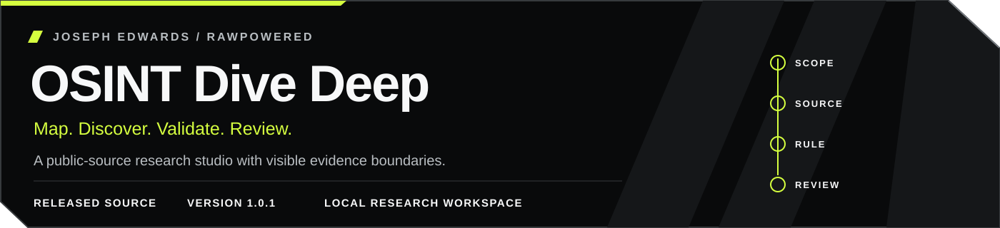
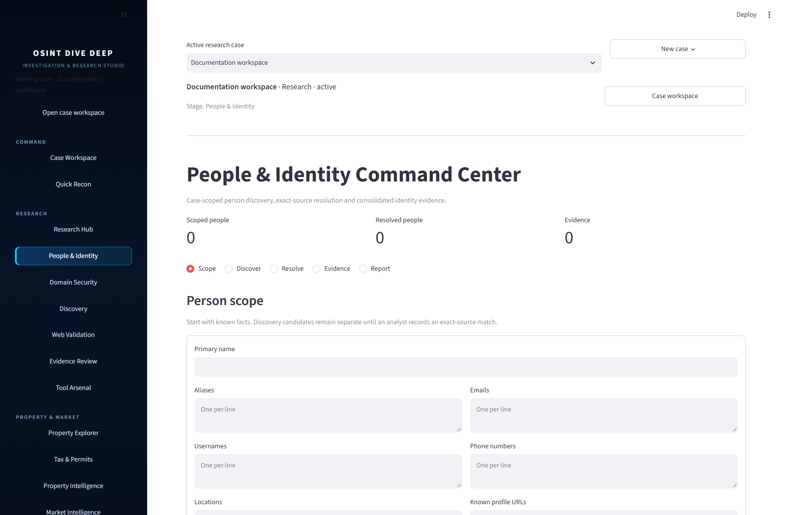
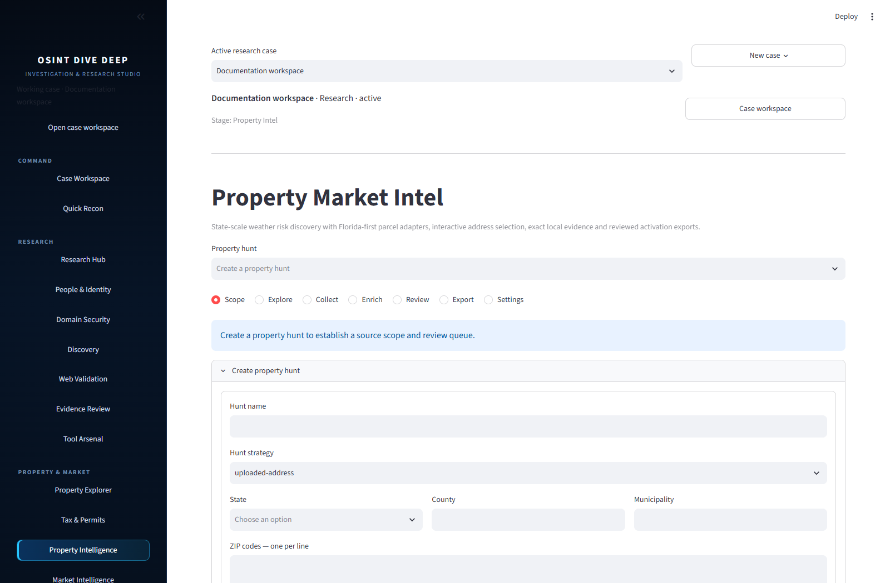
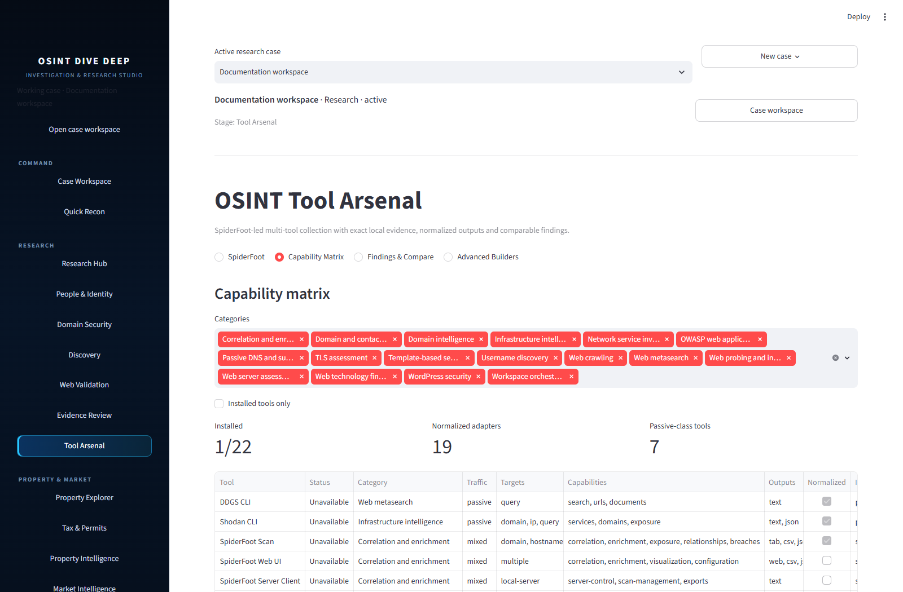
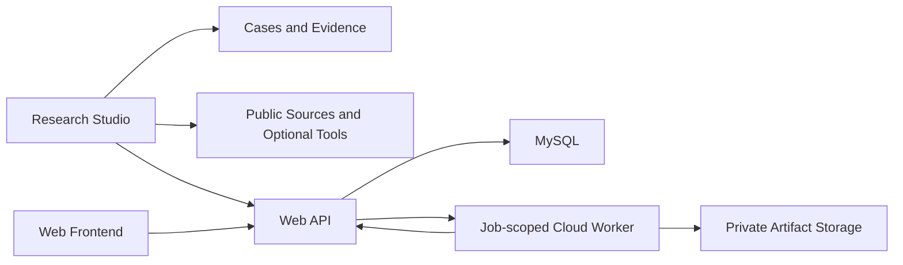

<div align="center">



# OSINT Dive Deep v1

**Follow the evidence. Connect the context.**

An investigation workspace for people, properties, domains, and public-source evidence.

[](LICENSE)
[](docs/SETUP.md)
[](https://github.com/RawPowered/osint-dive-deep-v1/actions/workflows/verify.yml)

[Download v1](https://github.com/RawPowered/osint-dive-deep-v1/releases/latest) · [Get started](#start-investigating) · [Complete stack](docs/ARCHITECTURE.md) · [Configuration](docs/SETUP.md)

</div>

## Investigation workspaces

| Workspace | What you can do |
| --- | --- |
| **People & Identity** | Collect public identifiers, compare possible identity links, research usernames, and record findings in a case. |
| **Property & Geography** | Explore parcels, ownership context, tax and permit sources, maps, weather exposure, and market context. Source coverage varies by region; several adapters target Florida public records. |
| **Domain & Infrastructure** | Research domains and indexed infrastructure with tool adapters including Shodan and passive discovery utilities. |
| **Discovery & Validation** | Build your own search matrix, collect candidates, validate public pages, and apply evidence rules and extractors. |
| **Cases & Evidence** | Keep entities, observations, research runs, provenance, and artifacts together for review and export. |
| **Tool Arsenal** | Discover installed tools and prepare scoped workflows for Sherlock, Maigret, Shodan, and other supported utilities. |
| **Privacy & Image Research** | Review exposure and image findings, prepare privacy workflows, and connect approved jobs to the web platform. |

**Shodan, Sherlock, and Maigret have adapters in this release.** Their executables and provider accounts are separate dependencies. No paid API access or third-party datasets are bundled. Findings and username matches need human verification.

## Inside the studio

Actual interface screenshots from an isolated, empty documentation case. No real subjects, properties, accounts, or search results were loaded. Optional tools are shown with their detected availability.

| Research Hub | People & Identity |
| --- | --- |
|  |  |
| **Property Intelligence** | **Tool Arsenal** |
|  |  |

## Start investigating

Install Python 3.12 or 3.13, download or clone this repository, then run:

**Windows — PowerShell**

```powershell
python launch.py
```

**Linux**

```sh
python3 launch.py
```

The launcher creates an isolated environment and installs the studio dependencies on first use. Open **http://127.0.0.1:8501**. Start a case and enter your own research scope. Nothing runs automatically.

The studio works independently of the web platform. Optional tools may have different operating-system requirements; Linux is recommended for the wider security-tool collection. See [setup and optional tools](docs/SETUP.md).

## Complete stack



| Component | Included source | Runs on |
| --- | --- | --- |
| Research studio | Streamlit UI, local API, case store, property research, discovery and tool adapters | Windows / Linux |
| Web platform | Node API, administration, customer workflow, SQL migrations and integration adapters | Windows / Linux with MySQL 8 |
| Frontend | Standalone customer pages; also included in the web platform's public assets | Web browser / static hosting |
| Cloud worker | Headless worker, Dockerfile, locked dependencies, Cloud Run build/deploy helpers | Linux container / Google Cloud Run |

Hosted operation requires your own database, domains, credentials, storage, and cloud project. It is not needed for local research. [Architecture and deployment boundaries →](docs/ARCHITECTURE.md)

## Blank by design

This public edition contains no saved cases, identities, property targets, search campaigns, API keys, deployment domains, customer data, or private brand artwork. Provider addresses remain where required for source adapters. Configuration examples leave deployment credentials and origins empty.

Local research data uses a separate `osint-dive-deep` data directory outside the repository. Configure `OSINT_STUDIO_DATA_DIR` and `OSINT_STUDIO_CACHE_DIR` to change it. Runtime data, environments, exports, and credentials are excluded from release packaging.

## Development

```sh
python -m pip install -r studio/requirements.txt
cd studio
python -m unittest discover -s tests -v
```

```sh
cd web
npm ci
npm test
```

See [release verification](docs/RELEASE.md) for the source allowlist and safety checks. Component compatibility versions are retained for API/worker negotiation; the public product release is **v1.0.1**.

The product name is **OSINT Dive Deep v1**. Its current release **1.0.1** contains studio engine **5.29.0** and web backend **1.16.0**; those component versions serve different compatibility contracts. [Version authorities and consistency checks](docs/RELEASE.md#version-and-naming-contract).

## License

[GNU GPL v3 only](LICENSE). Third-party tools retain their own licenses and terms. Use research and active tooling only within your authorization and applicable source rules.

Version policy update (1.0.1): the studio now labels the product release and engine separately. Component compatibility numbers remain unchanged. Flow Fountain for CRMs is a separate product with its own release history.
